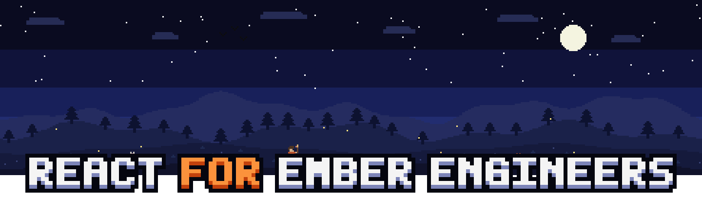
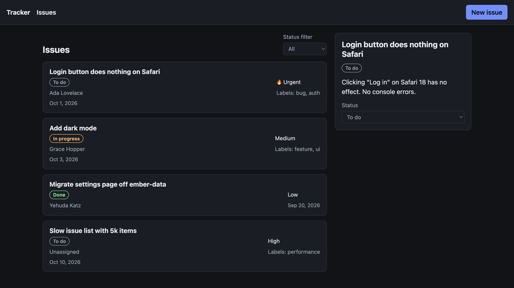
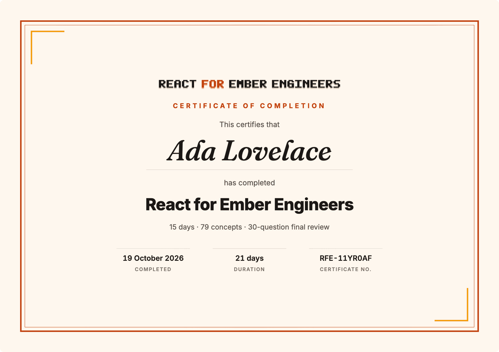

<p align="center"></p>

A 15-day course, at most an hour a day, for engineers who know Octane/Polaris Ember well and are new to React. You already know what components, routes and tests are for, so the course skips those basics. Instead it covers how React's model differs from Ember's, and spends most of its time where Ember instincts will mislead you.

Every exercise builds part of one small issue tracker, and on Day 15 you put the parts together into a running app.

## What you'll build

<p align="center"></p>

By Day 15 you have a working issue tracker built from your own code. You can list issues and filter them by status (the filter lives in the URL), open one in a detail pane, change its status, and create issues in a modal form. It runs against a fake in-memory API with real latency, so loading states, errors and cache updates all behave as they would against a server.

Each day you build the pieces the app needs, and each piece is tested on its own:

| Days | You build | Where it ends up |
|---|---|---|
| 1–2 | `StatusBadge`, `IssueCard`, a composable `Card` and keyed lists | the issue cards |
| 3–4 | a board with derived state, the `NewIssueForm`, a quick search | the "New issue" form |
| 5 | an issue detail that fetches without races, a live feed, a ticking relative time | effects you'll reuse |
| 6 | an issue table whose rows don't re-render while you type next to it | |
| 7–8 | context with a reducer, an external store, custom hooks (`useLocalStorage`, `useDebouncedValue`) | |
| 9 | TanStack Query hooks with cache invalidation, plus error boundaries | all the data loading and saving |
| 10 | React Router routes with loaders, a 404 and an error page | the URLs, the filter and the detail pane |
| 11 | an `EditTitle` with `useActionState` and an optimistic status toggle | a stretch goal for the detail pane |
| 12 | the issue list as Server Components with a Server Function | a Next.js version on the side |
| 13 | tests for a `Tabs` component that catch five planted bugs | |
| 14 | a `Modal`, an `Accordion` and a `TextField` with refs and portals | the "New issue" modal |
| 15 | `App.tsx`: one router, one query client, everything wired together | the app itself |

Days 1, 4, 9, 10 and 14 plug straight into the app. The other days teach the ideas around them: performance, state architecture, hooks, Actions, Server Components and testing. Run `pnpm dev:solutions` to see the reference version.

## Built to remember

Reading about a concept once is not the same as being able to use it two weeks later. So the course is built around a few well-studied learning techniques, aimed at keeping what you learn on Day 3 still there on Day 15:

- **Retrieval practice.** Every day ends with a quiz that makes you recall each idea instead of reading it again. Recalling an answer is what makes it stick.
- **Spaced repetition.** From Day 2, each quiz brings back three questions from earlier days, Leitner-style. If you miss one, it comes back the next day. If you get it right, it waits longer each time: 2 days, then 4, then 8.
- **Interleaving.** The earlier questions are mixed in with the new ones, each tagged with the day it came from. You have to work out which idea applies, so you can't answer on autopilot.
- **Wrong answers that tempt you.** The wrong choices are what an Ember engineer would reasonably guess, such as expecting a mutated property to re-render the way `@tracked` does. Catching your own instinct in the act is the point.
- **Feedback that explains.** Every answer, right or wrong, shows why, so even a lucky guess teaches you something.
- **A boss rush and a final review.** Day 15 has a 15-question boss rush drawn from the whole course and weighted towards the questions you've missed, then a 30-question final review.
- **Small, frequent wins.** You earn coins, combos, a rank and a hi-score for each day. The reading bar drops a coin when you finish a day's concepts, and the page celebrates when a day's tests go green.

## Your certificate

<p align="center"></p>

Finish all 15 days and you get a certificate of completion. It shows your name, what you covered (15 days, 79 concepts and the tests you passed), the date you finished, how long it took and a certificate number. You can print it or save it as a PDF to share.

## Quick start

You need **Node 22.22 or newer** and **pnpm** (`corepack enable` sets up the pinned version).

```sh
git clone https://github.com/linearza/react-for-ember-engineers.git
cd react-for-ember-engineers
pnpm install
pnpm start
```

Your browser opens the course at **http://localhost:1515**. Leave that terminal running for the 15 days, and come back to the same tab each day.

## How it works

Each day takes about an hour:

1. **Concepts (~15 min).** Read the day on the course page. Each concept puts Ember and React side by side and is flagged 🟢 direct translation · 🟡 same goal, different mechanics · 🔴 new mental model. A pixel bar at the top of the page fills up as you read, and a coin pops in when you reach the end.
2. **Hands-on (~35 min).** Open the day's files in `exercises/dayNN/` and follow the TODO comments. Every time you save, the tests run and the course page ticks off the ones that pass. Open a failing test to see the full error, including what your component rendered, plus anything it logged with `console.log`.

   Days 1–3 also show your components live in a playground under the tests, with a console panel underneath, and it updates as you save. Open it in its own tab (**Open with devtools ↗**) to debug with the browser devtools and React DevTools, the way you would under `ember serve`.
3. **Check yourself (~10 min).** Press start for a short multiple-choice quiz. Each answer comes with the reasoning, and you earn coins, combos and a rank along the way. A few questions from earlier days come back too, as described in [Built to remember](#built-to-remember).

Days unlock one at a time: when all of a day's tests pass, the day is marked complete, the page celebrates and the next day opens. Finish all 15 and you get [your certificate](#your-certificate).

The first time you open the page, a short "How this course works" guide pops up. Reopen it any time from the **?** button.

On Day 15 your assembled app runs at **http://localhost:1515/app/**.

Good to know:

- Port 1515 is busy? Run `PORT=1516 pnpm start`.
- Progress lives in `.progress.json` (it's gitignored). Delete it to start over.
- You can also open `course/index.html` straight from disk and tick days off by hand. It works offline.
- Stuck for 10 minutes? Each day has a reference solution in `solutions/dayNN/`. `git diff --no-index exercises/day05 solutions/day05` compares it with yours.

## The 15 days

| Week | Day | Topic |
|---|---|---|
| 1 · Core model | 1 | JSX, components, rendering |
| | 2 | Props, children, composition, lists & keys |
| | 3 | State: `useState`, immutability, derived state |
| | 4 | Events & forms: controlled vs uncontrolled, refs |
| | 5 | Effects: synchronising with external systems |
| 2 · Architecture | 6 | Rendering performance: reconciliation, memoization, React Compiler |
| | 7 | State architecture: Context, reducers, external stores |
| | 8 | Custom hooks |
| | 9 | Data fetching: TanStack Query, Suspense, error boundaries |
| | 10 | Routing with React Router 8 (data mode) |
| 3 · Modern & advanced | 11 | React 19 Actions & concurrent features |
| | 12 | Server Components & the Next.js App Router |
| | 13 | Testing React well (mutation testing) |
| | 14 | Patterns, TypeScript & modern APIs |
| | 15 | Capstone + final review |

## The stack

Everything you write runs on this stack, pinned in `package.json`:

| Layer | What | Where |
|---|---|---|
| UI | **React 19.3** + React DOM, in **TypeScript 5.9** (TSX) | every day |
| Performance | **React Compiler** (opt-in) | Day 6 |
| Server data | **TanStack Query 5** | Day 9, Day 15 |
| Routing | **React Router 8**, data mode | Day 10, Day 15 |
| Server | **React Server Components** and Server Functions, with **Next.js App Router** conventions | Day 12 |
| Build and dev server | **Vite 8** | every day |
| Tests | **Vitest 5** + jsdom, **Testing Library** (React, user-event, jest-dom) | every day, Day 13 in depth |
| Tooling | **Node 22.22+**, **pnpm 11** | |

The Day 12 exercise runs in Vitest rather than a real Next.js app, and its stretch goal moves it into one. The API is an in-memory fake, so the exercises have no backend or network dependencies.

Mentioned for context, but not used in the exercises: MSW, Zustand and Redux Toolkit, TanStack Router and TanStack Virtual, `react-error-boundary`, React Hook Form and Playwright.

## Stretch goals

- **Day 6: React Compiler.** Remove the `memo`/`useCallback` from your `IssueTable` and let the compiler do it:
  ```sh
  pnpm add -D @rolldown/plugin-babel @babel/core babel-plugin-react-compiler
  ```
  ```ts
  // vite.config.ts
  import react, { reactCompilerPreset } from '@vitejs/plugin-react';
  import babel from '@rolldown/plugin-babel';
  // plugins: [react(), babel({ presets: [reactCompilerPreset()] })]
  ```
  The Day 6 tests should still pass. (`@vitejs/plugin-react` also has an experimental Rust compiler: `react({ compiler: true })` with `oxc-transform-react`.)
  The typing case also has a fix with no memo at all: move the "Draft note" input and its state into their own component, and typing never re-renders the table ("move state down").
- **Day 8:** make `useLocalStorage` sync across tabs (the `storage` event, ideally via `useSyncExternalStore`).
- **Day 9:** make the status change optimistic with `onMutate` / `onError` rollback / `onSettled` invalidate.
- **Day 10:** add `<ViewTransition>` or a pending UI with `useNavigation()`; try the same routes in TanStack Router for type-safe params.
- **Day 12:** `pnpm create next-app@latest`, drop `exercises/day12/app/issues` into `app/`, and watch the boundaries work for real (add `revalidatePath` to the action).
- **Day 13:** write a sixth mutant your checks *don't* catch, then add a check for it.
- **Day 15:** add the Day 11 `EditTitle` to the detail pane, and the Day 5 `LiveIssueFeed`.

## Ember → React cheat sheet

| Ember | React | Flag |
|---|---|---|
| Glimmer component class | Function component | 🟡 |
| `@arg` / `this.args` | props | 🟢 |
| `@tracked` + mutation | `useState` + immutable replace | 🔴 |
| getter over tracked state | value computed during render (`useMemo` only if expensive) | 🟢 |
| `{{yield}}` / named blocks | `children` / ReactNode props | 🟢 / 🟡 |
| `{{yield x}}` block params | render prop | 🟡 |
| `{{yield (hash Item=(component …))}}` | compound components + context | 🟡 |
| `{{#each key=}}` | `.map()` + `key` | 🟢 |
| `{{on "click"}}` | `onClick` | 🟢 |
| modifiers / `registerDestructor` | `useEffect` + cleanup, refs | 🟡 |
| helpers | plain functions / hooks | 🟢 |
| services (DI) | Context + provider, external stores | 🟡 |
| ember-resources | custom hooks | 🟡 |
| ember-concurrency (`restartable`, `isRunning`) | effect cleanup, Query status, transitions / `useActionState` | 🟡 |
| ember-data / WarpDrive store | TanStack Query cache | 🟡 |
| Router.map / model hook / `{{outlet}}` | route objects / loader / `<Outlet/>` | 🟢 |
| query params | `useSearchParams` | 🟡 |
| loading / error substates | `useNavigation` / `errorElement`, Suspense / error boundaries | 🟢 / 🟡 |
| `{{#in-element}}` | `createPortal` | 🟢 |
| FastBoot | SSR / RSC | 🔴 |
| `@ember/test-helpers` + `await settled()` | Testing Library + `findBy` / `waitFor` | 🟡 |
| autotracking (fine-grained) | re-render + reconcile (+ Compiler) | 🔴 |

## Under the hood

Stack: React 19.3, React Router 8 (data mode), TanStack Query 5, Vite 8, Vitest 5 + Testing Library, TypeScript 5.9. TypeScript 7, the native Go port, exists, but this repo stays on 5.9 for editor and tooling stability, and nothing here depends on the difference.

`pnpm start` runs one Vite server that serves the course page at `/`, your Day 15 app at `/app/` and each day's playground at `/app/play.html?day=N`, with Vitest in watch mode in the same process. A small reporter streams the results to the page, with each test's full failure message and its console output.

### Your work vs. the solutions

Tests import `@ex/dayNN/...`. One switch in `vite.config.ts` decides what `@ex` points at:

| Command | `@ex` resolves to | Use |
|---|---|---|
| `pnpm start` | `exercises/` | the course, live progress and your app |
| `pnpm test day05` | `exercises/` | one day's tests in watch mode |
| `pnpm exec vitest run` | `exercises/` | check everything you've done so far |
| `pnpm test:solutions` | `solutions/` | reference run: 104/104 pass |
| `pnpm dev` | `exercises/` | run *your* Day 15 app |
| `pnpm dev:solutions` | `solutions/` | run the reference app |
| `pnpm typecheck` | — | `tsc --noEmit`: passes for both trees |

The stubs fail on purpose: against an untouched `exercises/`, every test fails, so each tick means you changed something. Cross-day imports, such as Day 15 importing Day 9's hooks, also go through `@ex`. So `pnpm dev` runs the app on *your* earlier days, which makes it a good integration check.

### Layout

```
src/domain/       shared issue-tracker domain: types, seed data, fake async API (like Mirage), pub/sub, test helpers
src/day13/        the Tabs component + 5 mutants for the testing exercise
exercises/dayNN/  your files: stubs with TODOs
solutions/dayNN/  reference implementations
tests/dayNN.test.tsx  one test file per day
scripts/start.mjs `pnpm start`: course server + test watcher
course/index.html the course page (generated from course/source/)
index.html, src/main.tsx, src/styles.css   the dev app (= Day 15 capstone)
play.html, src/play/   the playground: src/play/dayNN.tsx lists what to render for a day
```

To give another day a playground, add `src/play/dayNN.tsx` exporting `scenarios: Scenario[]` (a title, an optional hint and a `render` function). Rebuild the course page with `pnpm build:course` and it embeds the playground for that day.

The fake API (`@domain/api`) has test controls: `setLatency(ms)` (300 in dev, 0 in tests), `setIssueLatency(id, ms)` for race conditions, `failNextRequest(msg)`, `resetDb()`, `getDbSnapshot()`.
